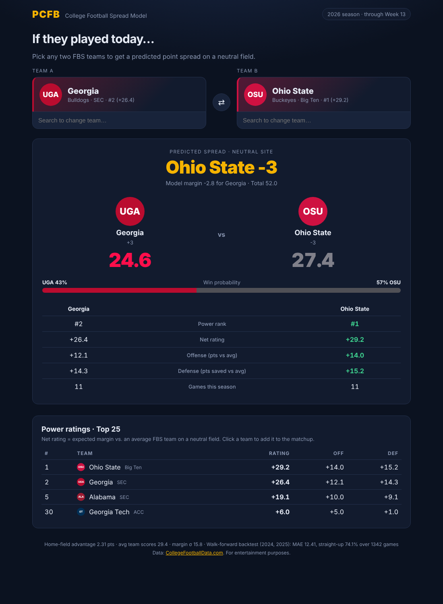

# PCFB — College Football Spread Model

A full-stack app that fits its own power-rating model on [CollegeFootballData.com](https://collegefootballdata.com) data and predicts the point spread between any two FBS teams **if they played today on a neutral field**.



| Layer | Tech |
|---|---|
| Backend | Python 3.12 · FastAPI · SQLAlchemy 2 · numpy |
| Database | PostgreSQL 16 |
| Frontend | Node 22 · React 18 · Vite (served by nginx in Docker) |
| Data | CollegeFootballData.com REST API |
| CI | GitHub Actions (tests, lint, frontend build, Docker build) |

## Quick start (Docker)

1. Get a free API key at <https://collegefootballdata.com/key>.
2. `cp .env.example .env` and set `CFBD_API_KEY` (and `ADMIN_TOKEN`).
3. `docker compose up --build`
4. Open <http://localhost:8080>.

On first start the backend sees there's no model, pulls the last `HISTORY_SEASONS` seasons from CFBD (about 4 API calls per season), fits the model, and runs a walk-forward backtest. The page shows "Building the model…" and refreshes itself when it's ready (usually under a minute). After that it re-pulls the current season and retrains every `REFRESH_INTERVAL_HOURS` (default 24).

API docs: <http://localhost:8000/docs>

## Local development (without Docker for the app)

```bash
docker compose up -d db                       # just Postgres

cd backend
python -m venv .venv && source .venv/bin/activate
pip install -r requirements-dev.txt
export CFBD_API_KEY=...                       # DATABASE_URL defaults to localhost:5432 pcfb/pcfb
python -m app.cli refresh                     # ingest + train
uvicorn app.main:app --reload                 # http://localhost:8000
pytest

cd ../frontend
npm install
npm run dev                                   # http://localhost:5173 (proxies /api to :8000)
```

### CLI

```bash
python -m app.cli refresh [--full]            # ingest current season (+ missing history) and retrain
python -m app.cli ingest --seasons 2023 2024  # ingest specific seasons
python -m app.cli train                       # retrain from what's in Postgres
python -m app.cli backtest                    # walk-forward accuracy of the active params
python -m app.cli tune --apply                # grid-search hyperparameters, retrain with the best
python -m app.cli predict Georgia "Ohio State"
```

## API

| Method | Path | Description |
|---|---|---|
| GET | `/api/health` | Liveness |
| GET | `/api/model` | Active model run: season, data through, HFA, σ, params, backtest metrics |
| GET | `/api/teams` | FBS teams with offense/defense/net ratings and rank |
| GET | `/api/rankings?limit=25` | Power ratings, best first |
| GET | `/api/predict?team_a={id}&team_b={id}` | Neutral-site spread, projected score, win probability |
| POST | `/api/admin/refresh` | Re-ingest + retrain in the background (header `X-Admin-Token`) |

Example `/api/predict` response (abridged):

```json
{
  "team_a": { "school": "Georgia", "projected_points": 24.6, "win_probability": 0.43, "rating": 26.4 },
  "team_b": { "school": "Ohio State", "projected_points": 27.4, "win_probability": 0.57, "rating": 29.2 },
  "margin": -2.8,
  "spread": { "display": "Ohio State -3", "line": -3.0, "team_a_line": 3.0, "favorite_id": 194 },
  "total": 52.0
}
```

## The model

Every team gets an **offense** and a **defense** rating, fit jointly with a league scoring level `mu` and home-field advantage `hfa`:

```
points(team vs opp) = mu + offense[team] − defense[opp] ± hfa/2     (0 on a neutral site)
```

Ratings are solved by **weighted ridge regression toward a preseason prior** (`backend/app/model/ratings.py`):

- **Opponent adjustment.** Scoring 35 against an elite defense counts for more than 35 against a weak one, because both teams' ratings are fit simultaneously.
- **Preseason prior.** Each team's prior is last season's final rating × `carryover` plus a roster-talent bump (247 Sports talent composite z-score × `talent_coef`). `prior_weight` is roughly how many games the prior is worth, so it carries September and fades as real results come in.
- **Recency.** Game weights decay with a `half_life_weeks` half-life, so recent form matters more.
- **Blowout dampening.** Margin past `blowout_cap` (28) only counts at `blowout_excess` (30%), so running up the score doesn't inflate a rating.
- **FCS opponents** are pooled into one pseudo-team.
- **Season chaining.** Seasons are fit oldest → newest, and each one's final ratings seed the next one's prior.

**Prediction.** For a neutral site, projected points are `mu + off_A − def_B` and `mu + off_B − def_A`. The spread is the difference, rounded to the nearest half point. Win probability is `Φ(margin / σ)`, where σ is the RMSE from the backtest.

**Evaluation.** `backtest` replays the last two complete seasons week by week, predicting each week using only games played before it. It reports MAE, RMSE, bias, and straight-up accuracy on FBS-vs-FBS games. `tune` grid-searches the main hyperparameters against walk-forward MAE.

Ratings shown in the UI are centered on the FBS average, so a **+20 net rating** means "20 points better than an average FBS team on a neutral field."

## Project layout

```
backend/
  app/
    main.py            FastAPI routes + background refresh scheduler
    cli.py             ingest / train / backtest / tune / predict
    pipeline.py        refresh job (ingest → train), concurrency guard
    cfbd_client.py     CollegeFootballData.com client (retries, auth)
    normalize.py       raw CFBD JSON → table rows (handles v1 + v2 field names)
    ingest.py          idempotent Postgres upserts
    models.py          SQLAlchemy schema
    model/ratings.py   the model (pure numpy, fully unit tested)
    model/service.py   load from DB, train, persist, serve predictions
  tests/
frontend/
  src/App.jsx, components/  single-page React UI
docker-compose.yml     db + backend + frontend (nginx proxies /api)
.github/workflows/ci.yml
```

### Schema

`teams`, `team_seasons` (FBS membership by season), `games`, `team_talent`, `model_runs` (params, metrics, σ, HFA, active flag), `team_ratings` (per-run offense/defense/net/rank). Each training run is stored, so you can compare model versions over time.

## Ideas for next POCs

- Ingest betting lines (`/lines`) and report against-the-spread record vs. the market
- Add efficiency features (`/stats/game/advanced`: EPA/play, success rate) as a second rating component
- Projected game-day spreads with home field and travel, plus a weekly slate page
- Alembic migrations, auth, and a managed deploy (Render/Fly/Cloud Run + managed Postgres)
- Track model runs in MLflow; schedule retrains with GitHub Actions cron
