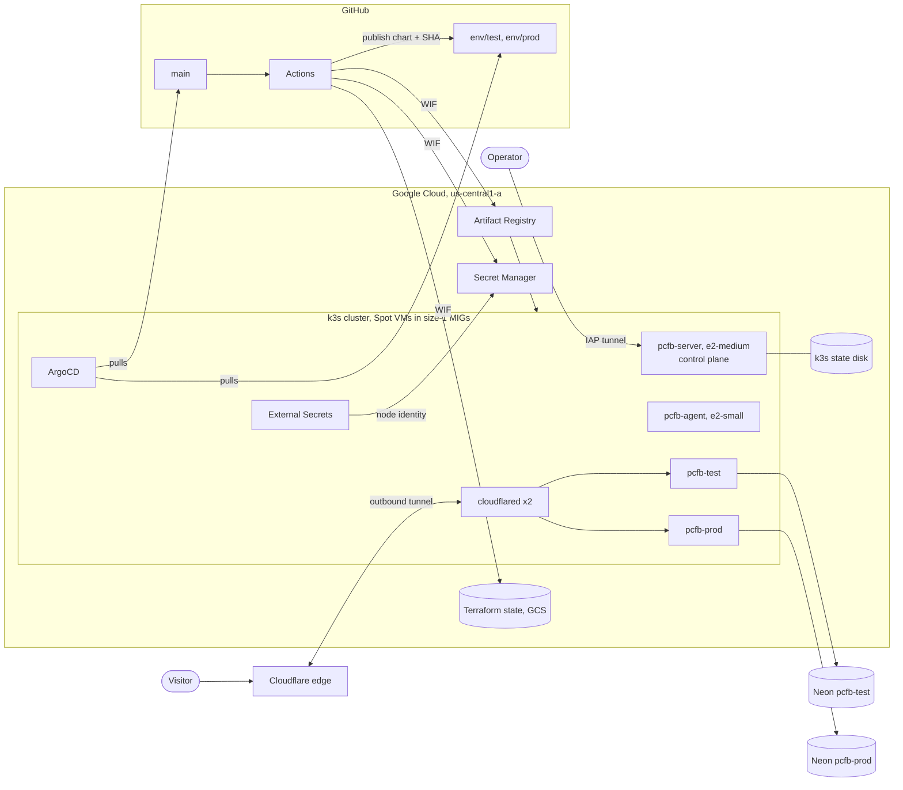

# PCFB platform

PCFB runs on a two-node k3s cluster on Google Cloud Spot VMs, deployed with Terraform and ArgoCD, for an estimated $28 a month. No service account keys exist: GitHub Actions and the cluster both use short-lived credentials.

- Prod: <https://probablycollegefootball.com>
- Test: <https://test.probablycollegefootball.com>

## Architecture



| Layer | Choice | Why |
|---|---|---|
| Cluster | k3s on 2 Spot VMs, each in a managed instance group of size 1 | Low cost, and preempted nodes are recreated automatically |
| Ingress | Cloudflare Tunnel | No load balancer and no public ingress rules |
| Egress | Ephemeral external IPs | $3.65/month, against about $5.69 plus $0.045/GB for Cloud NAT |
| Admin access | IAP TCP forwarding | The Kubernetes API and SSH are never public |
| Database | Neon, one project per environment | Free, and separate from the cluster's lifecycle |
| Secrets | Secret Manager, synced by External Secrets Operator | One source of truth, nothing in git |
| Delivery | ArgoCD tracking `env/test` and `env/prod` | `main` stays protected, and prod pins both chart and image |

### Terraform roots

| Root | Contains | Applied by |
|---|---|---|
| `infra/bootstrap` | State bucket, APIs, WIF, service accounts, budget | Operator, once |
| `infra/platform` | Network, VMs, disks, registry, secrets, Neon, Cloudflare | CI on merge to `main` |
| `infra/cluster` | ArgoCD and the root app | Operator, through IAP |

ArgoCD has its own root because a Helm provider can't plan against a cluster the same root hasn't created yet. Applying it by hand also means CI holds no cluster credentials.

### Delivery flow

1. **Pull request:** tests, builds, Terraform and chart checks, and a `terraform plan` comment.
2. **Merge to `main`:** build and push images tagged with the commit SHA, apply `infra/platform`, publish the chart and SHA to `env/test`.
3. **Promote to prod:** run the `Promote to prod` workflow. It fixes the SHA running on test, waits for approval in the `production` environment, and publishes the same SHA to `env/prod`.

CI refuses any plan that deletes a disk, secret, image registry or Neon project.

## Cost

Prices are from the Cloud Billing catalog on 2026-11-25, for 730 hours. This is an estimate, not a bill.

| Component | $/month |
|---|---|
| Server, e2-medium Spot | 14.68 |
| Agent, e2-small Spot | 7.34 |
| Two external IPs (Spot rate) | 3.65 |
| k3s state disk, 15 GB pd-balanced | 1.50 |
| Boot disks, 2 x 20 GB pd-standard (30 GB free) | 0.40 |
| Artifact Registry, Secret Manager, GCS (estimated) | 0.45 |
| Neon Free, Cloudflare, IAP, budget alerts | 0.00 |
| **Total** | **28.02** |

A $30 monthly budget alerts at 50%, 90% and 100%. Alerts don't cap spending, and Spot prices change.

## Spot preemption

- Each managed instance group recreates its VM when it is preempted.
- Node names are fixed (`pcfb-server`, `pcfb-agent`), and node passwords come from Secret Manager, so a recreated VM rejoins as the same node.
- The server's `/var/lib/rancher/k3s` is on its own disk with a reserved internal IP, so cluster state survives. The startup script formats that disk only if it reads back as blank.

Both nodes were preempted once with `gcloud compute instances simulate-maintenance-event`:

| Node | Result |
|---|---|
| Agent | Ready about 60 s after the old VM terminated |
| Server | API unreachable for about 2 min 15 s; state disk re-attached and data intact |

Both nodes stopped responding before the preemption was recorded, for a reason not yet explained. A real preemption hasn't been observed.

**Limits:** there is one server, in one zone. While it is down nothing can be scheduled and pods on it are offline. If the zone has no Spot capacity, the VM stays down until it does.

## Security model

- **CI:** a planner identity for pull requests and a deployer for `push` and `workflow_dispatch` on `main`. Both are bound to the repository's numeric ID. Fork pull requests get no cloud access.
- **Powerful by design:** the deployer can read every secret in the project, and code on a same-repo pull request branch can use the Cloudflare and Neon tokens. Keep write access to the owner.
- **Terraform state** holds no generated passwords: write-only arguments and `scripts/sync-secrets.sh` keep them out.
- **CI logs and comments are public.** Never redirect `scripts/mask-tokens.sh` output to a file. The plan comment is built from the saved plan and checked for tokens before it is posted.
- **Metadata server:** blocked by NetworkPolicy in the app and cloudflared namespaces. Pods in other namespaces can still get their node's credentials.

### Replacing the ESO service account with Workload Identity Federation

External Secrets currently uses the server node's attached service account. To give it its own identity (not yet tested here):

1. Set a k3s issuer with `kube-apiserver-arg: ["service-account-issuer=<URL>"]` in the server's config.
2. Export the signing keys: `kubectl get --raw /openid/v1/jwks`.
3. In Terraform, add a workload identity pool provider with that issuer and the keys as `jwks_json`. Uploading the keys means the issuer needn't be public.
4. Grant `roles/secretmanager.secretAccessor` on the app secrets to the External Secrets Kubernetes service account's principal.
5. Set `auth.workloadIdentityFederation` with `serviceAccountRef` and `audience` on the `ClusterSecretStore`.
6. Remove the node account's secret access, and extend the metadata block to every namespace.

## Runbook

Every command runs from the repository root. Open the tunnel in one terminal and leave it running:

```bash
./scripts/tunnel.sh
```

Then, in another:

```bash
./scripts/kubeconfig.sh                  # first time, or after a rebuild
export KUBECONFIG=~/.kube/pcfb.yaml      # cluster-admin: keep this file private
kubectl get nodes
kubectl get applications -n argocd
```

### Common tasks

```bash
# Refresh data and retrain now (about 16 CFBD calls on an empty database, 4 after that)
kubectl create job -n pcfb-prod refresh-$(date +%s) --from=cronjob/pcfb-refresh

# ArgoCD UI at https://localhost:8443, user admin
kubectl -n argocd get secret argocd-initial-admin-secret -o jsonpath='{.data.password}' | base64 -d
kubectl -n argocd port-forward svc/argocd-server 8443:443

# Plan the platform locally
./scripts/tf.sh init && ./scripts/tf.sh plan

# Which commit is each environment on?
git fetch && git show origin/env/test:DEPLOYED_SHA origin/env/prod:DEPLOYED_SHA
```

To roll back prod, revert the latest commit on `env/prod` with `git revert` and push. Force pushes are blocked.

### Rotate secrets

Define this first. It reads the value at a hidden prompt, so nothing reaches shell history:

```zsh
put() { local v; read -rs "v?$1: "; echo; printf %s "$v" | gcloud secrets versions add "$1" --data-file=- --project pcfb-platform; }
```

| Secret | Steps |
|---|---|
| `cfbd-api-key`, `admin-token-test`, `admin-token-prod` | `put <name>`, then apply to pods |
| `database-url-*` | Reset the `pcfb` role's password in Neon, `./scripts/sync-secrets.sh neon <env>`, then apply to pods |
| `cloudflare-tunnel-token` | Refresh the tunnel token in Cloudflare, `./scripts/sync-secrets.sh tunnel`, then restart cloudflared |
| `ci-neon-api-key`, `ci-cloudflare-api-token` | Create the new one, `put <name>`, revoke the old one |
| `k3s-join-token` | Untested. Run `k3s token rotate` on the server first, then store the same value |

Apply to pods, shown for prod:

```bash
kubectl annotate externalsecret -n pcfb-prod pcfb-secrets force-sync=$(date +%s) --overwrite
kubectl rollout restart -n pcfb-prod deploy/backend

# For the tunnel token:
kubectl annotate externalsecret -n cloudflared tunnel-token force-sync=$(date +%s) --overwrite
kubectl rollout restart -n cloudflared deploy/cloudflared
```

Afterwards, destroy the old version: `gcloud secrets versions destroy <n> --secret=<name> --project pcfb-platform`.

Don't bump `secret_data_wo_version` in `infra/platform/secrets.tf` on its own. It regenerates the join token and both node passwords at once, and nodes would fail to rejoin.

### Rebuild from scratch

The full sequence hasn't been run end to end.

1. **Bootstrap:** move `infra/bootstrap/backend.tf` aside, set `TF_VAR_billing_account`, apply `infra/bootstrap`, restore the file, then run `terraform init -migrate-state`.
2. **Secret containers:** they must exist before `scripts/tf.sh` can read its tokens. In `infra/platform`, set `NEON_API_KEY` and `CLOUDFLARE_API_TOKEN` in the shell for this one step and run `terraform apply -target=google_secret_manager_secret.this`.
3. **Values:** `put` the CFBD key, both CI tokens and both admin tokens.
4. **Platform:** `./scripts/tf.sh apply`
5. **Generated credentials:** `./scripts/sync-secrets.sh neon test`, then `neon prod`, then `tunnel`.
6. **Images:** run the deploy workflow on `main` so images for the current commit exist.
7. **Cluster:** open the tunnel, fetch the kubeconfig, then `terraform -chdir=infra/cluster init` and `apply`.
8. **Data:** run a refresh job in each namespace.

If only the VMs are lost, none of this is needed. The managed instance groups recreate them.

### Tear everything down

```bash
./scripts/destroy-all.sh --dry-run   # show what would be destroyed
./scripts/destroy-all.sh             # asks for typed confirmation
```

This deletes both databases and can't be undone. Only the dry run has been tested. It keeps bootstrap, which costs a few cents a month. To remove that too, pull its state locally, delete the `prevent_destroy` block, run `terraform destroy`, then delete the bucket. Workload identity pools are soft-deleted, so their names stay reserved for a while.

## Manual one-time steps

| Where | Step |
|---|---|
| Google Cloud | Create the project and link billing; `gcloud auth application-default login` |
| Cloudflare | API token limited to this zone: Tunnel Edit, DNS Edit, Zone Read. Turn on **Always Use HTTPS** |
| Neon | Organization API key |
| CFBD | API key |
| GitHub | Public repository; `production` environment with a required reviewer; rulesets for `main` and `env/*`; secret scanning and push protection; workflow approval for all outside contributors |

## Not built yet

- OpenTelemetry Collector DaemonSet and gateway, in the `observability` namespace. The agent will probably need to become an e2-medium (+$7.34/month).
- Workload Identity Federation for External Secrets.
- Backups beyond Neon's 6-hour history. The data can be rebuilt from CFBD with a refresh.
